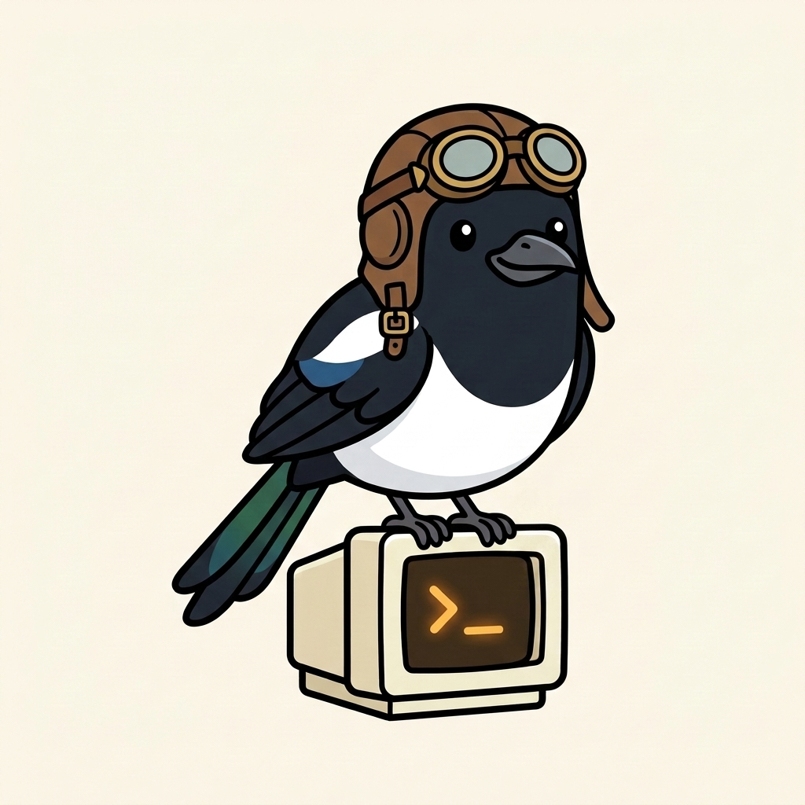

# Magpilot

<p align="center">
  
</p>

> Your Copilot sessions, from any browser.

Magpilot is a self-hosted web client and terminal companion for
[GitHub Copilot CLI](https://github.com/github/copilot-cli). Start work at
your desk, continue from your phone, and take it back in the terminal.
The conversation stays with the same project on the same machine.

Your computers do the work. Magpilot gives you one place to reach them.

## What you can do

- **Work across machines.** Choose a host, start a chat in a project directory,
  or find and resume an existing Copilot session.
- **Move between terminal and browser.** The `magpilot` launcher coordinates
  session ownership with the web client so they don't write to the same
  conversation at once. Handoff is cooperative first, with an explicit
  force-takeover option when needed.
- **Follow the work live.** Stream responses, reasoning, and tool activity.
  Review permission requests in the chat, interrupt a turn, or queue the
  next message.
- **See session usage.** View the current model, reasoning effort, context
  usage, and session AI Credits. Change model and reasoning while the
  agent-owned session is idle.
- **Share a hub with trusted users.** GitHub sign-in and an allowlist control
  access; browser users see their own agents, with cross-user management
  available to the administrator.
- **Run your own clients.** Use the HTTP API and server-sent events (SSE)
  for integrations, including named long-lived sessions and one-shot prompts.

The web UI works on desktop and mobile browsers. No phone app is required.

## How it works

```text
Browser (desktop or phone)
            |
           Hub
            |
     +------+------+
     |             |
   Agent         Agent        One per host
     |             |
 Copilot SDK   Copilot SDK
  runtime       runtime

Terminal --> magpilot launcher --> Copilot CLI
                       |
                  Local agent  (session handoff)
```

The **hub** serves the Blazor WebAssembly UI, handles browser sign-in, and
routes requests to the right host. Each **agent** runs Copilot through the
public GitHub Copilot SDK, using its bundled runtime and the host's files,
tools, and configuration. Session history lives in the host's Copilot
session store.

The **launcher** runs your installed `copilot` in the terminal and coordinates
handoff with the local agent. It is installed as `magpilot`; it does not
replace or shadow `copilot`.

The hub discovers agents over LAN UDP broadcast. Pairing authorizes a host;
discovery alone does not grant access. Broadcast discovery does not cross
VPNs or routed networks, so those setups need an explicitly reachable agent
address. See the [architecture guide](docs/architecture.md) for the details.

## Get started

You need GitHub Copilot access, a hub reachable from your browser, and an
agent on each machine you want to use. For terminal sessions, install and
authenticate [Copilot CLI](https://github.com/github/copilot-cli) under the
same user account that runs the agent. The agent's SDK runtime is bundled;
the launcher uses the separately installed CLI.

### 1. Set up a hub

The published Linux image is
[`ghcr.io/chsienki/magpilot-hub`](https://github.com/chsienki/magpilot/pkgs/container/magpilot-hub).
The [deployment guide](deploy/README.md) includes an example Docker Compose
stack, persistent storage, reverse-proxy settings for streaming, and update
instructions. Adapt its hostnames and paths to your environment.

Configure a GitHub OAuth App with a callback at
`https://<your-hub>/oauth/callback`, set `OAUTH_CLIENT_ID`,
`OAUTH_CLIENT_SECRET`, and `OAUTH_ALLOWED_GITHUB_USERS`, and choose a strong
`MAGPILOT_HUB_BEARER` for non-browser API callers. Set
`MAGPILOT_HUB_PUBLIC_URL` to the URL your clients can reach.

**Keep the hub and agents on a trusted network or VPN.** Hub-to-agent traffic
uses HTTP with per-agent bearer tokens, not built-in TLS. Put HTTPS in front
of the browser-facing hub. Agents can edit files and run commands as their
host user; they are not sandboxes. Never enable `MAGPILOT_DEV_BYPASS_AUTH`
on a shared deployment.

### 2. Install and pair a Windows host

Run in PowerShell:

```pwsh
irm https://raw.githubusercontent.com/chsienki/magpilot/main/scripts/install.ps1 | iex
```

The script downloads the latest installer from
[Releases](https://github.com/chsienki/magpilot/releases), verifies its SHA256
checksum, and requests elevation. You can also download the installer
directly. The installer is unsigned, so Windows may show a SmartScreen warning.

The installer adds the agent and launcher, registers the agent to run at user
logon, and starts pairing. It discovers your hub and opens its **Agents**
page. Compare the fingerprint shown in the console with the pending request,
then click **Adopt**. Pairing writes the connection settings and per-agent
credentials for you.

If discovery is unavailable, create an enrollment bundle on the hub's
`/admin/enroll` page and run:

```pwsh
magpilot "--magpilot-pair=<bundle>"
```

The [installer guide](installer/README.md) covers silent installs, headless
pairing, and troubleshooting.

For an always-on Linux agent, use
[`ghcr.io/chsienki/magpilot-agent`](https://github.com/chsienki/magpilot/pkgs/container/magpilot-agent)
with your own credentials, persistent home directory, and optional bootstrap
hooks. See the [Linux image deployment contract](deploy/README.md#generic-linux-agent-image).

### 3. Start in the terminal, continue in the browser

In your project directory:

```pwsh
magpilot
```

Use `magpilot` rather than bare `copilot` for cooperative handoff. To resume
an existing session, use the searchable picker:

```pwsh
magpilot --resume
```

Open your hub in a browser, choose the host and conversation, and use
**Take back** to move a terminal-owned session into the browser. The launcher
hands it over and waits for you to press Enter to take it back at the terminal.
If a graceful handoff cannot complete, the web client offers a separate
**Force take over** action.

Useful launcher commands:

| Command | Purpose |
|---|---|
| `magpilot --magpilot-update` | Install the latest Windows release, preserving pairing settings |
| `magpilot --magpilot-pair` | Repeat interactive pairing |
| `magpilot --magpilot-version` | Show launcher and agent version information |
| `magpilot --magpilot-no-tui-changes` | Keep handoff coordination without Magpilot's terminal styling |
| `magpilot --magpilot-help` | Show launcher options |

## Current limits

Magpilot is under active development. The packaged desktop install targets
Windows x64; the hub and generic agent images target Linux amd64.

- There is no standalone Magpilot Android app or push-notification delivery.
  Phone access is through the browser.
- The browser uses the Copilot SDK, not a remote terminal. Interactive CLI
  slash commands are not available there; browser controls expose selected
  operations such as model and reasoning changes.
- Keep hub, agents, and launchers on matching releases. The wire protocol is
  not yet frozen, and mixed-version deployments are not supported.

## Build from source

Use the **.NET 10 SDK**, with the **.NET 9 / ASP.NET Core 9 runtimes** available
for the services and their tests. The launcher targets .NET 10; the other
projects target .NET 9. Windows is the CI build and test environment.

```pwsh
git clone https://github.com/chsienki/magpilot.git
cd magpilot
dotnet build Magpilot.slnx
dotnet test Magpilot.slnx
```

To publish the web UI into the hub's static content, run:

```pwsh
.\scripts\build-hub.ps1
```

The [local development guide](AGENTS.md#build-run-deploy) covers running the
agent and hub, environment variables, and avoiding conflicts with an installed
agent.

## Documentation

| Guide | Contents |
|---|---|
| [Architecture and API](docs/architecture.md) | Session lifecycle, HTTP/SSE contract, ownership, and client integration |
| [Deployment](deploy/README.md) | Container images, storage, reverse proxy, and updates |
| [Windows installer](installer/README.md) | Installation, pairing, upgrades, and headless setup |
| [Contributor guide](AGENTS.md) | Development workflows, configuration, and implementation gotchas |
| [Terminal theme tools](tools/tui-matrix/README.md) | Capture diagnostics and the offline theme editor |

Integrations belong outside the platform: **satellites know about Magpilot;
Magpilot does not know about satellites.** Build against the HTTP API or supply
deployment-time bootstrap hooks rather than adding product-specific behavior
to the hub or agent.
